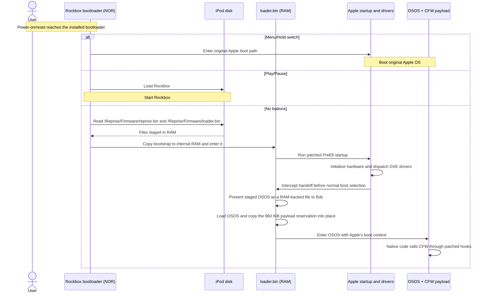

# Boot sequence

Buttons held at startup select the system:

| Controls | System |
| --- | --- |
| No buttons | RepriseOS |
| Menu or Hold switch | Original Apple OS |
| Play/Pause | Rockbox |
| Previous | RepriseOS without extensions |

The patched Rockbox bootloader reads the first three; RepriseOS reads Previous
once it has started.

## After a crash

RepriseOS shows "We ran into an error" and the path of a crash report. Press
Center to restart. The report is saved to `/Reprise/Crashes/<report-id>.txt` at
the next start and holds the saved registers and a short piece of the stack.
Attach it when you open an issue. Holding Menu and Center, or a flat battery
before the next start, loses the report. A crash early in startup shows the
register screen instead and saves no report; Center restarts there too.

A crash inside an extension names it on the screen and in the report. That
extension is skipped at every start until its `.rvx` file changes: replace it
with another build, or delete it, start once and copy it back. Holding Previous
while RepriseOS starts loads no extension for that start.

## RepriseOS boot

The companion adapts Apple's startup and image-loading path to the decrypted
firmware. Its Apple code patches live in RAM. Compatible companion, OSOS, and
bootloader builds share the file-loading and memory interface.

## Current memory layout

The payload occupies 1 MiB at `0x08b33000`. The OSOS patch moves the heap start
to `0x08c33000`, and the companion copies the appended payload into that reservation.

Native driver initialization matters: Rockbox disk reads do not establish
that Apple's ATA and OSOS state are initialized. The companion resumes DXE
dispatch, then intercepts the transition to Bds selection. See [NOR drivers](nor.md)
and [OSOS relocation](osos.md).
