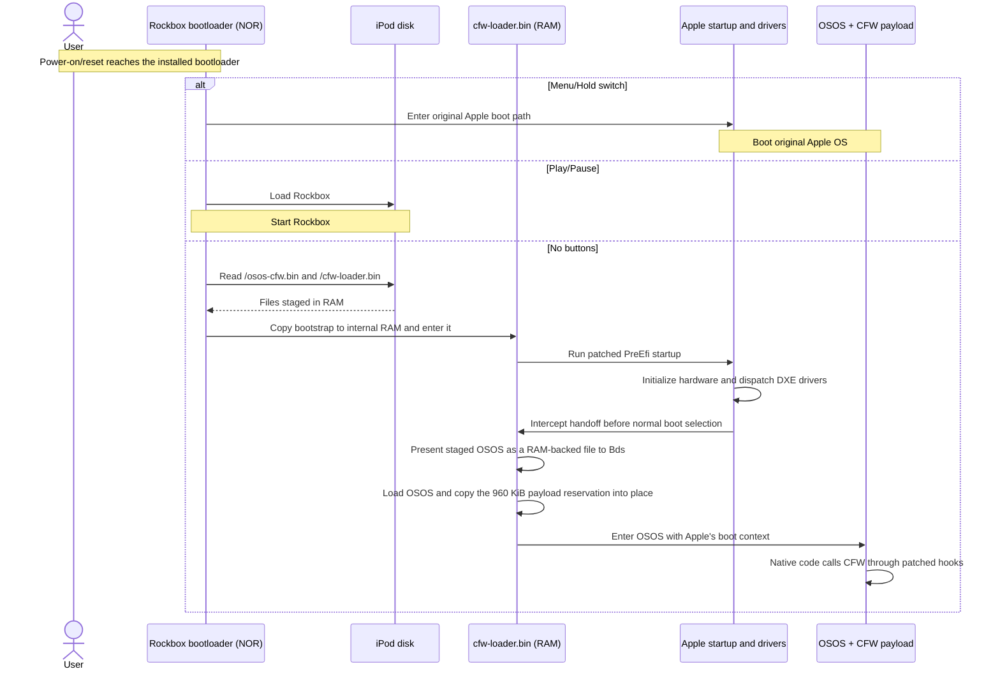

# Boot sequence

The patched Rockbox bootloader selects the system at startup:

| Controls | System |
| --- | --- |
| No buttons | RepriseOS |
| Menu or Hold switch | Original Apple OS |
| Play/Pause | Rockbox |

## RepriseOS boot

The companion adapts Apple's startup and image-loading path to the decrypted
firmware. Its Apple code patches live in RAM. Compatible companion, OSOS, and
bootloader builds share the file-loading and memory interface.

## Current memory layout

The payload is linked at `CFW_PAYLOAD_BASE` (`0x08b3c000`, above Apple's BSS) and
may use at most `CFW_PAYLOAD_BYTES` (960 KiB). Each build appends only its linked
size, rounded to 32 bytes, to the OSOS image; the companion copies those bytes into
place. The OSOS patch moves the native heap start from `0x08b3b1b0` to the end of
the linked payload, so every byte the payload links is taken from the heap.
`CFW_PAYLOAD_BUDGET` (132 KiB) caps the linked size well below that maximum; the
link fails when the payload exceeds it, so raising it is an explicit change.

Native driver initialization matters: Rockbox disk reads do not establish
that Apple's ATA and OSOS state are initialized. The companion resumes DXE
dispatch, then intercepts the transition to Bds selection. See [NOR drivers](nor.md)
and [OSOS relocation](osos.md).
